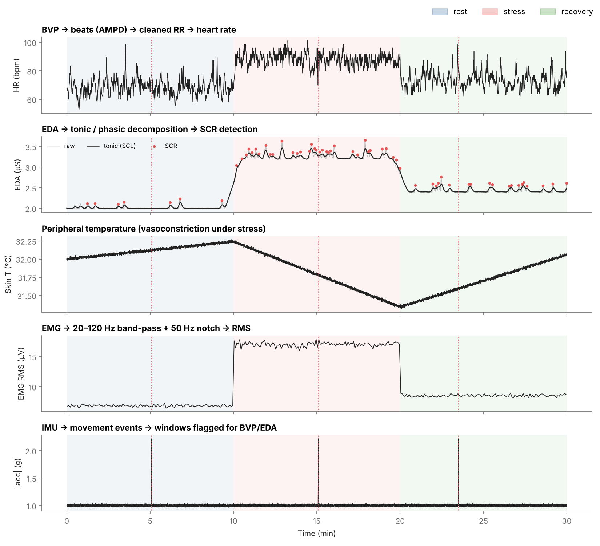
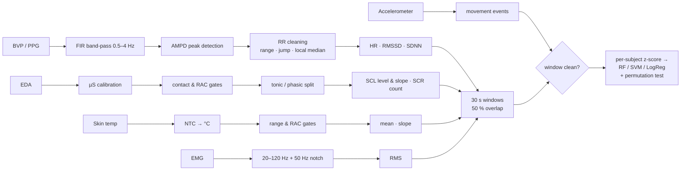
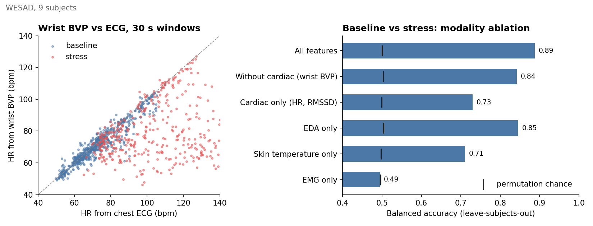
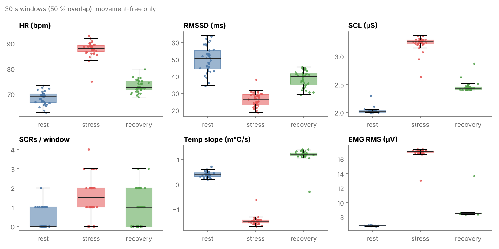

# Multimodal wearable physiology pipeline

Signal processing and machine-learning pipeline for **stress / activation detection from wearable biosignals**: BVP (PPG), electrodermal activity, peripheral skin temperature, surface EMG and accelerometry.

It was developed for my Bachelor's thesis (Universidad de Sevilla, Signal Theory & Communications Dept.) within **DACIU**, a research programme exploring whether physiological signals can help understand the internal state of people with **profound intellectual and multiple disabilities (PIMD)**, who cannot report it verbally. This repository contains the **method only**: the code, tests, a synthetic demo and a validation on the public **WESAD** dataset. No participant data is included (see [Data & ethics](#data--ethics)).


<sub>Synthetic 30-min session (rest → stress → recovery) run through the full pipeline. Dotted red lines: movement events detected by the IMU. Note how each one produces a spurious heart-rate spike, which is why those windows are discarded.</sub>

## Pipeline



| Signal | Processing | Features per window |
|---|---|---|
| **BVP** | Zero-phase FIR band-pass (512 taps, Hamming); systolic peaks with **AMPD** (Scholkmann 2012), no amplitude threshold; three-stage RR filter (30–200 bpm, >50 % beat-to-beat jump, >25 % from local median); spectral-entropy quality gate (Böttcher 2022) | HR, HR std, RMSSD, SDNN |
| **EDA** | Device calibration µV → µS; contact gate (<0.05 µS) and rapid-amplitude-change gate; tonic/phasic split (0.05 Hz low-pass); SCR detection with adaptive threshold from a rest segment, 5 s refractory period, first minute discarded | SCL mean & slope, SCR count |
| **Skin temperature** | NTC thermistor β-model → °C; biological range (25–40 °C) and RAC gates; least-squares slope on 60 s windows | mean, slope (m°C/s) |
| **EMG** | 4th-order Butterworth 20–120 Hz + 50 Hz notch | RMS |
| **IMU** | Movement = acceleration peaks above median + 0.5 g | `IMU_ok` flag: windows with movement are discarded |

**Design choice — the IMU as a quality gate.** Movement corrupts the pulse waveform and electrode contact. Rather than trying to repair BVP/EDA, the accelerometer decides which windows are trustworthy. Two window-level threshold rules (mean + 2σ, median + 3·MAD) were tried first and rejected: a single short movement gets diluted in a 30 s RMS, but it is exactly what ruins that window's heart rate.

**Evaluation.** With few subjects and overlapping windows, a high accuracy alone means little. Every model is evaluated with a **permutation test** (Ojala & Garriga, 2010), refitting on label-shuffled data to obtain the chance level and a p-value. Across subjects, evaluation is **leave-subjects-out** (`GroupKFold`), so the model never sees the test person.

## Validation on WESAD

[WESAD](https://ubicomp.eti.uni-siegen.de/home/datasets/icmi18/) (Schmidt et al., 2018) records wrist (Empatica E4) and chest (RespiBAN) signals during baseline and a stress test (TSST). I used the wrist BVP, EDA, temperature and accelerometer, plus chest EMG, for 9 subjects (S2, S3, S5, S9, S10, S13, S14, S16, S17), with baseline vs stress windows and leave-subjects-out CV.



| Model (all features) | Balanced accuracy | Chance | p |
|---|---|---|---|
| Random Forest | **0.89** | 0.50 | 0.01 |
| SVM (RBF) | 0.89 | 0.50 | 0.01 |
| Logistic Regression | 0.87 | 0.50 | 0.01 |

What the results show:

- **EDA carries most of the signal** (0.85 alone). Skin temperature adds independent information (0.71 alone).
- **Wrist heart rate is reliable at rest but not under stress.** Against the chest ECG, the wrist-BVP heart rate has a median error of 1.5 bpm at baseline but 15.6 bpm during the stress test, where talking and gesturing corrupt the pulse. Cardiac features still help (0.84 → 0.89), but this is the main limitation of wrist PPG for this use case.
- **Chest EMG alone is at chance** for this protocol (p = 0.53): the TSST is a speaking task, not a muscle-tension one.

Reproduce with `python examples/run_wesad.py /path/to/WESAD`. The raw dataset is not redistributed here.

## Quick start

```bash
pip install -r requirements.txt
python examples/demo_synthetic.py   # full pipeline on a synthetic session, regenerates the figures
pytest                              # 11 tests: beat detection vs ground truth, filters, gates, calibration
```

```python
from physio import Recording, extract_features

rec = Recording(bvp=bvp, fs_bvp=64, eda_us=eda, fs_eda=4, temp_c=temp, fs_temp=4,
                emg=emg, fs_emg=700, acc_mag=acc, fs_acc=32)
features = extract_features(rec, win_s=30, step_s=15)   # one row per window
```



## Repository structure

```
physio/
  bvp.py           filtering, AMPD beats, RR cleaning, HRV, spectral-entropy gate
  eda.py           µS calibration, quality gates, tonic/phasic, SCR
  temperature.py   NTC conversion, slope, quality gates
  emg.py           band-pass + notch, RMS
  imu.py           movement events, clean-window mask
  features.py      synchronised windowed feature matrix
  ml.py            models + permutation testing (within- or across-subject)
  io.py            Bitbrain VersaBio exports, WESAD loader
  synthetic.py     synthetic multimodal session for demos and tests
examples/          synthetic demo, WESAD experiment
tests/             pytest suite
docs/figures/      figures in this README
results/           WESAD metrics
```

## Data & ethics

The thesis recordings come from people with PIMD and volunteers, collected in collaboration with a care centre under informed consent. **That data is not, and will not be, in this repository**, nor are figures derived from it. The pipeline was adapted from the thesis notebooks into reusable modules; results on the original cohort are reported in a paper currently under review.

## References

- Scholkmann F. et al. (2012). An efficient algorithm for automatic peak detection in noisy periodic and quasi-periodic signals. *Algorithms* 5(4).
- Böttcher S. et al. (2022). Data quality evaluation in wearable monitoring. *Scientific Reports* 12.
- Schmidt P. et al. (2018). Introducing WESAD, a multimodal dataset for wearable stress and affect detection. *ICMI '18*.
- Ojala M., Garriga G. (2010). Permutation tests for studying classifier performance. *JMLR* 11.
- Task Force of the ESC and NASPE (1996). Heart rate variability: standards of measurement. *Circulation* 93(5).

## Author

**María Varela Caraballo**: Telecommunications Engineer (Universidad de Sevilla), M2 SAR student at CentraleSupélec / Université Paris-Saclay. [LinkedIn](https://www.linkedin.com/in/mar%C3%ADa-varela-caraballo)

MIT License.
